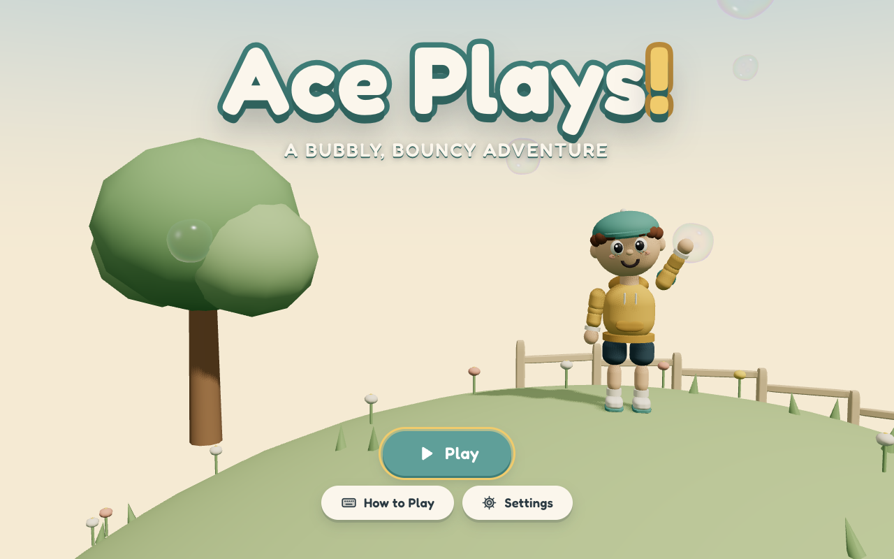
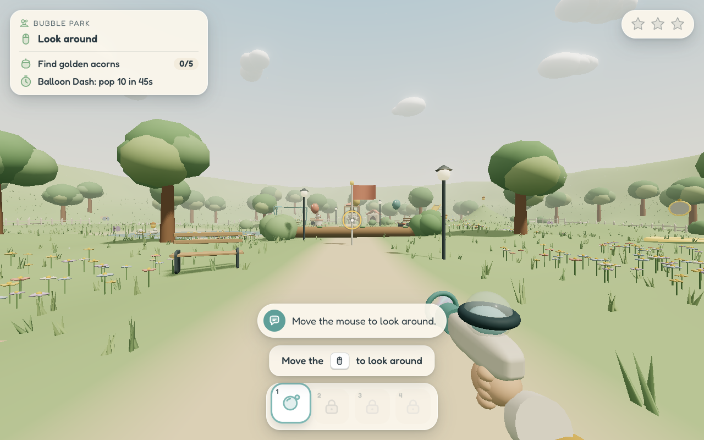
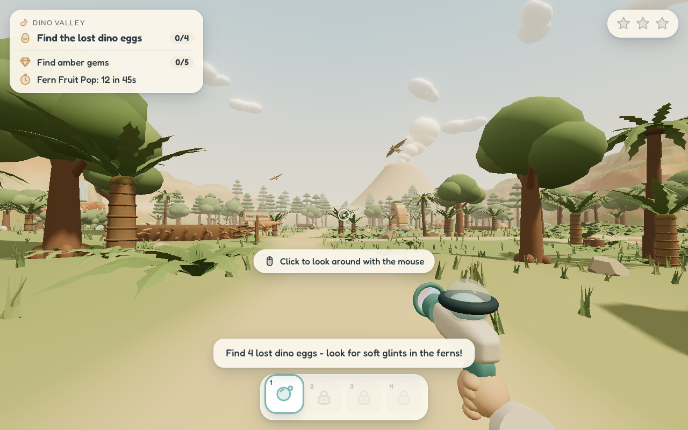
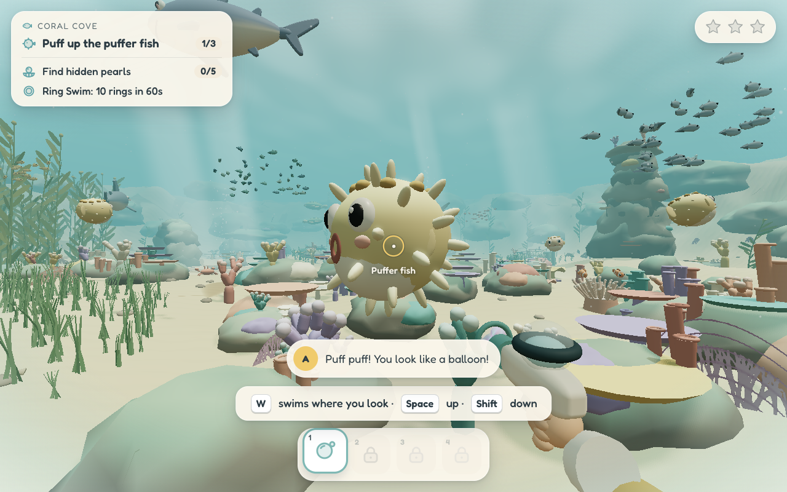
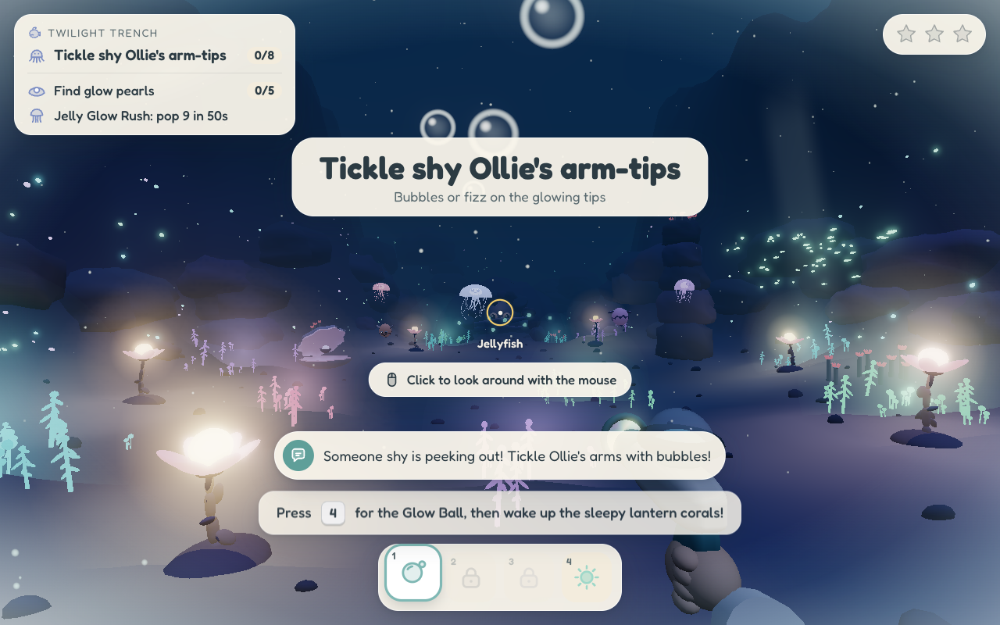
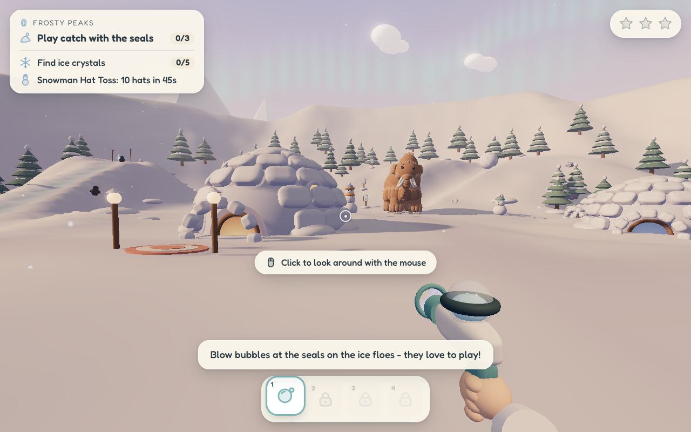
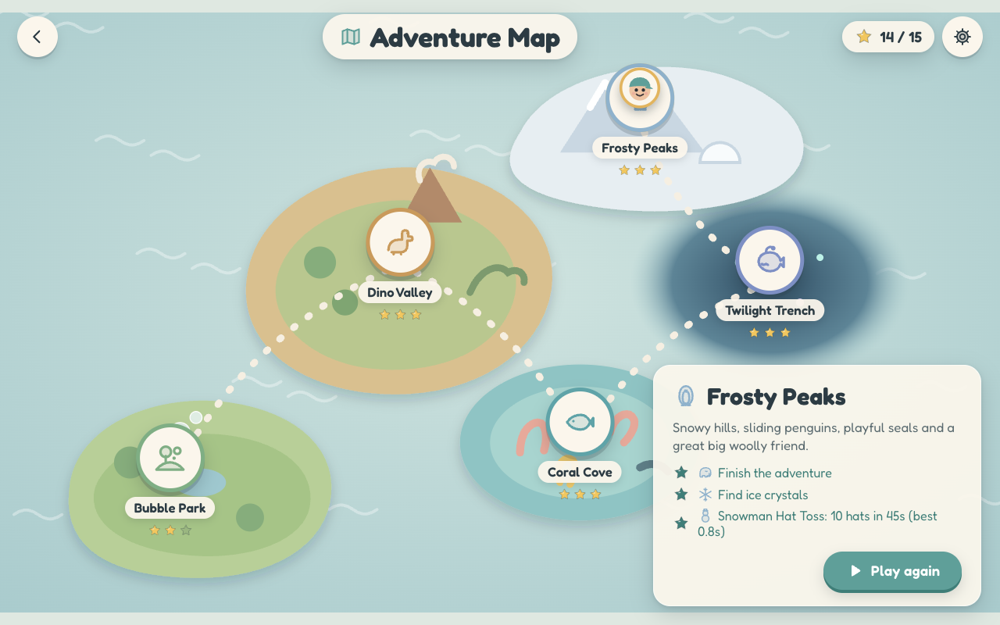

# Ace Plays!

**Ace Plays!** is a gentle, kid-friendly first-person adventure. You play as Ace, a cheerful
boy explorer with a backpack full of playful blasters that blow wobbly bubbles and launch
bouncy balls. Nobody ever gets hurt. Bubbled critters float away in a happy bubble, booped
sharks do a barrel roll, and targets pop into soft sparkles.

### ▶ [Play in your browser](https://ace-plays.tamarikigames.com)

Part of [Tamariki Games](https://tamarikigames.com/games/ace-plays/).

Works on computers, tablets and phones (turn your phone sideways for the best view). Prefer a desktop app? Grab one from the [latest release](https://github.com/d3bug21/ace-plays/releases/latest).



Explore five worlds:

| World | What happens there |
| --- | --- |
| **Bubble Park** | A sunny park tutorial. Pop balloons, give a bunny a bubble ride, ring the big bell, and play fetch with Biscuit, the fluffiest dog around. |
| **Dino Valley** | Friendly dinosaurs of all sizes. Find lost eggs, float baby chirpers home and cure Lulu the long-neck's hiccups. |
| **Coral Cove** | A sparkly shallow sea. Boop playful sharks, lead baby turtles home and pop Mama Mo the whale's song bubbles. |
| **Twilight Trench** | The cosy deep sea. Follow Glim the angler fish's little light, light up lantern corals and tickle shy Ollie the octopus. |
| **Frosty Peaks** | Snowy hills. Play catch with seals, float penguins home in BIG bubbles and roll a giant snowball to Woolly the mammoth. |

Each world has three stars to earn: finish the adventure, find all five hidden treasures,
and beat the timed challenge. Finishing worlds opens new ones on the map and unlocks new
blasters: the **Bubble Wand**, **Boing Ball**, **Fizz Fountain** and **Glow Ball**, plus the
**Big Bubble** ability.

| | |
| --- | --- |
|  |  |
|  |  |
|  |  |

## Controls

| Action | Keys |
| --- | --- |
| Look around | Move the mouse (click the game first) |
| Blow bubbles / launch balls | Left mouse button (hold to keep going) |
| Walk forward / back | `W` / `S` or `↑` / `↓` |
| Step left / right | `A` / `D` or `←` / `→` |
| Jump (underwater: swim up) | `Space` |
| Swim down | `Shift` or `C` |
| Pick a blaster | `1` `2` `3` `4`, `Q` / `E`, or the mouse wheel |
| Big Bubble (once unlocked) | Hold the mouse button with the Bubble Wand, then let go |
| Pause | `Esc` or `P` |
| Hints on/off | `H` |

**On phones and tablets:** turn your device sideways for the best view. A friendly reminder pops
up in portrait, and you can tap **Play anyway**. Drag on the left side to walk and drag on the right
side to look. Hold the bubble button and slide your thumb to aim while you blow bubbles. Push it
to the edge to keep turning. Tap 1-4 in the bottom bar (or the swap button) to change blasters. Tap the goals
card to see all your goals. You can also add Ace Plays! to your home screen: it launches full
screen like an app, and once loaded it keeps working offline.

Ace always moves the way he is looking, even when swimming. The **Settings** menu has mouse
sensitivity, an **Invert look up/down** option, separate **Music**, **Voices** and **Effects**
volume sliders, subtitles, head bob, field of view and a graphics quality switch.
Touch screens get an on-screen joystick and buttons.

## For grown-ups: building the game

You need [Node.js](https://nodejs.org/) 20 or newer.

```bash
npm install            # install the tools
npm run dev            # play in your browser at http://localhost:5173
npm run electron:start # build, then open the desktop app window
```

`npm run build:web` type-checks the code and writes a plain static website to `dist/`.
You can open it with any static file server. It also works as the desktop app's renderer.

### Web version

The browser version is hosted on Cloudflare Workers (static assets). `wrangler.jsonc` points
at `dist/`, so publishing an update is:

```bash
ELECTRON_SKIP_BINARY_DOWNLOAD=1 npm ci
npm run build:web
npx wrangler deploy
```

### Desktop packages

```bash
npm run package:mac    # macOS .dmg (Apple silicon + Intel) and .zip
npm run package:win    # Windows installer (.exe) and portable .zip
npm run package:linux  # Linux AppImage and .tar.gz
```

Packages are written to `release/`:

| OS | Files |
| --- | --- |
| macOS | `AcePlays-1.0.1-mac-arm64.dmg`, `AcePlays-1.0.1-mac-x64.dmg`, `AcePlays-1.0.1-mac-arm64.zip` |
| Windows | `AcePlays-1.0.1-win-x64.exe` (installer), `AcePlays-1.0.1-win-x64.zip` (portable) |
| Linux | `AcePlays-1.0.1-linux-x86_64.AppImage`, `AcePlays-1.0.1-linux-x64.tar.gz` |

`release/SHA256SUMS` lists checksums for every package. These are unsigned local builds. On macOS, right-click the app and choose **Open** the first
time. On Linux, make the AppImage executable (`chmod +x`) before running it. Building Windows
and Linux packages on a Mac works without Wine because Windows executable editing is turned off.

### Audio

All voices, sound effects and music were generated with [ElevenLabs](https://elevenlabs.io/)
and are bundled in `public/audio/`, so the game plays fully offline. `scripts/build_manifest.py`
lists every line and sound in `src/audio/manifest.json`. `scripts/generate_audio.mjs` can
regenerate missing files. It reads your key only from the `ELEVENLABS_API_KEY` environment
variable:

```bash
python3 scripts/build_manifest.py
ELEVENLABS_API_KEY=your-key-here node scripts/generate_audio.mjs           # only missing files
ELEVENLABS_API_KEY=your-key-here node scripts/generate_audio.mjs --force   # regenerate everything
```

Never commit an API key. `.gitignore` already excludes `.env` files and key files.

### Project layout

```
electron/        desktop main process + preload
src/core/        game loop, input, player movement, physics, saving
src/gameplay/    blasters, bubbles and balls, objectives, challenge courses
src/kit/         shared modelling kit (materials, faces, creatures, terrain)
src/fx/          bubble shader, particles, sky, underwater effects
src/stages/      one folder per world
src/ui/          menus, HUD, map, results, touch controls
src/audio/       mixer + audio manifest
public/audio/    bundled ElevenLabs audio
scripts/         audio manifest + generation scripts
tests/           local browser checks (screenshots, control-direction probe)
docs/            screenshots
```

## License

MIT © 2026 d3bug21. See [LICENSE](LICENSE).
